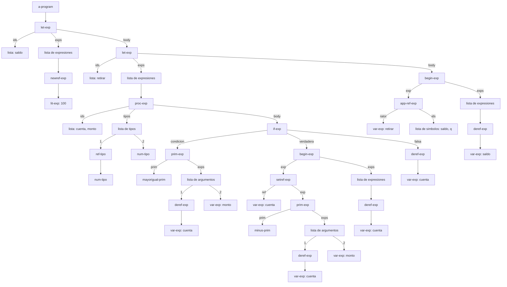
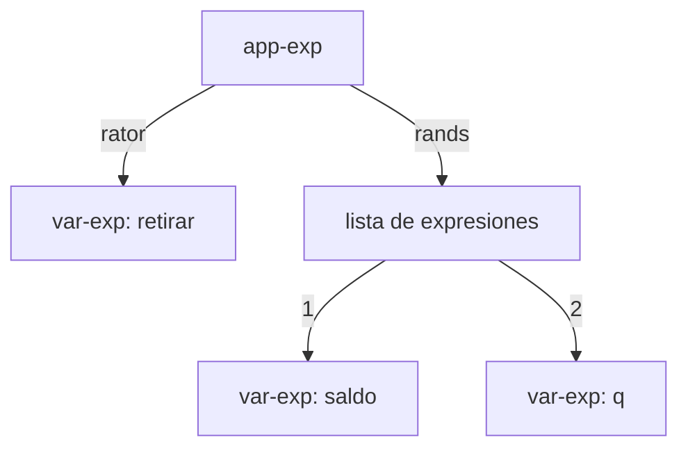
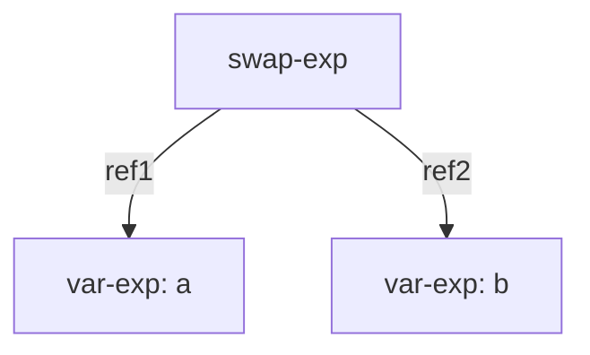
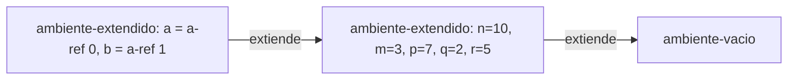
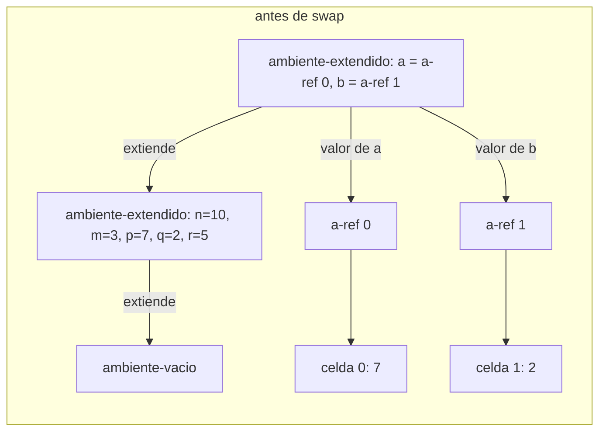
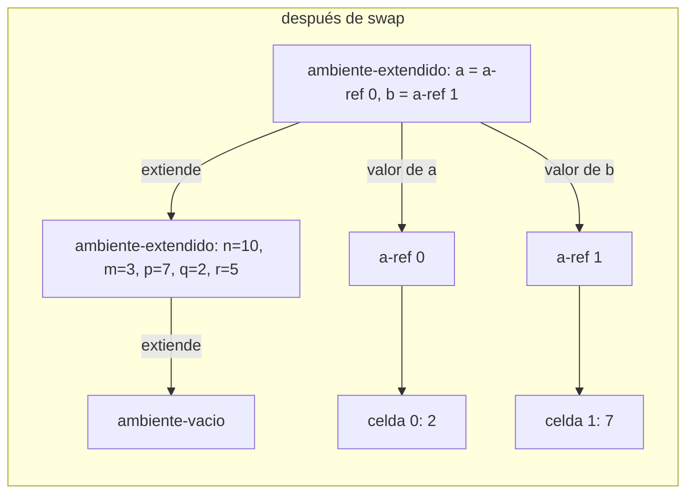

# Informe de AST — Taller 3: Memoria y disciplina

Curso: Fundamentos de Interpretación y Compilación de Lenguajes de
Programación — Universidad del Valle, Sede Tuluá.

## Integrantes del grupo

| Nombre | Código | Correo institucional |
|--------|--------|----------------------|
| Nicolás Cardona García | 2477349 | nicolas.cardona.garcia@correounivalle.edu.co |
| Laura Sofía Echeverry González | 2477067 | echeverry.laura@correounivalle.edu.co |
| Santiago Serrano Morales | 2477006 | serrano.santiago@correounivalle.edu.co |
| Samuel Esteban Peña Jaramillo | 2477399 | samuel.pena@correounivalle.edu.co |

---

## 1. Gramática considerada

Se utiliza la gramática de `src/sintaxis.rkt`. A continuación se
presenta el fragmento empleado en los programas de este informe.

La notación `{...}*` representa cero o más repeticiones.
La notación `{...}*(,)` representa una lista separada por comas,
posiblemente vacía. Para los argumentos de un tipo de procedimiento
se utiliza `*` como separador.

```bnf
<programa> ::= <expresion>
                a-program(exp)

<expresion> ::= <numero>
                  lit-exp(n)
              ::= <identificador>
                  var-exp(id)
              ::= <primitiva> "(" {<expresion>}*(,) ")"
                  prim-exp(prim, exps)
              ::= "if" <expresion> "then" <expresion>
                  "else" <expresion> "end"
                  if-exp(condicion, verdadera, falsa)
              ::= "let" {<identificador> "=" <expresion>}*
                  "in" <expresion> "end"
                  let-exp(ids, exps, body)
              ::= "proc" "(" {<identificador> ":" <tipo>}*(,) ")"
                  <expresion> "end"
                  proc-exp(ids, tipos, body)
              ::= "apply" <expresion> "(" {<expresion>}*(,) ")"
                  app-exp(rator, rands)
              ::= "applyref" <expresion>
                  "(" {<identificador>}*(,) ")"
                  app-ref-exp(rator, ids)
              ::= "newref" "(" <expresion> ")"
                  newref-exp(exp)
              ::= "deref" "(" <expresion> ")"
                  deref-exp(exp)
              ::= "setref" "(" <expresion> "," <expresion> ")"
                  setref-exp(ref, exp)
              ::= "swap" "(" <expresion> "," <expresion> ")"
                  swap-exp(ref1, ref2)
              ::= "begin" <expresion> {";" <expresion>}* "end"
                  begin-exp(exp, exps)

<tipo> ::= "num"
             num-tipo()
         ::= "bool"
             bool-tipo()
         ::= "refto" "(" <tipo> ")"
             ref-tipo(t)
         ::= "(" {<tipo>}*(*) "->" <tipo> ")"
             proc-tipo(args, res)

<primitiva> ::= ">="
                 mayorigual-prim()
             ::= "-"
                 minus-prim()
             ::= "+"
                 sum-prim()
             ::= "*"
                 mult-prim()
```

Los identificadores y las listas almacenados en los campos del AST
también se muestran en los diagramas. Los nodos auxiliares que
representan listas no son constructores adicionales del lenguaje.

Las anotaciones de tipo forman parte del AST. El intérprete las ignora,
mientras que el chequeador las utiliza.

---

## 2. Ejemplos de AST

### Ejemplo 1 — Programa original de saldo y retiro

#### Expresión concreta

```text
let saldo = newref(100)
in
  let retirar = proc (cuenta : refto(num), monto : num)
                  if >=(deref(cuenta), monto)
                  then begin
                         setref(cuenta, -(deref(cuenta), monto));
                         deref(cuenta)
                       end
                  else deref(cuenta)
                  end
                end
  in
    begin
      applyref retirar (saldo, q);
      deref(saldo)
    end
  end
end
```

#### AST completo



#### Explicación de la estructura

El programa contiene dos `let-exp` anidados. El primero liga `saldo`
a una referencia nueva y el segundo liga `retirar` a un procedimiento.

El procedimiento tiene dos parámetros y dos anotaciones de tipo:
`ref-tipo(num-tipo())` para `cuenta` y `num-tipo()` para `monto`.
Su cuerpo es un `if-exp`.

La condición compara el contenido de `cuenta` con `monto`. La rama
verdadera escribe el saldo reducido y luego lo lee; la falsa
únicamente lee el saldo.

El bloque principal contiene una aplicación por referencia y una
lectura final. En `app-ref-exp`, `saldo` y `q` son símbolos de la lista
de identificadores, no nodos `var-exp`.

#### Error de tipado

En el ambiente de tipos inicial, `q` tiene tipo numérico:

$$
\Gamma_0(q)=\mathrm{num}.
$$

El tipo de `retirar` es:

$$
(\mathrm{refto}(\mathrm{num}) * \mathrm{num}
\rightarrow \mathrm{num}).
$$

Sin embargo, `applyref` exige que todos los argumentos sean
identificadores ligados a referencias y que los parámetros
correspondientes tengan tipos de referencia compatibles.

El segundo argumento, `q`, no es una referencia. Además, el segundo
parámetro, `monto`, está declarado como `num`. Por tanto, la llamada
original no satisface la regla de `applyref`.

El programa es sintácticamente válido: el parser puede construir su
AST. El conflicto aparece durante el chequeo de tipos.

#### Corrección mínima

Se cambia únicamente la forma de aplicación:

```text
apply retirar (saldo, q)
```

El programa completo corregido es:

```text
let saldo = newref(100)
in
  let retirar = proc (cuenta : refto(num), monto : num)
                  if >=(deref(cuenta), monto)
                  then begin
                         setref(cuenta, -(deref(cuenta), monto));
                         deref(cuenta)
                       end
                  else deref(cuenta)
                  end
                end
  in
    begin
      apply retirar (saldo, q);
      deref(saldo)
    end
  end
end
```

Esta versión tiene tipo `num`, pero no modifica la celda original:
`apply` crea una celda nueva al copiar el argumento referencia.
El procedimiento trabaja con la copia, pasa de 100 a 98 y devuelve 98.
El bloque principal descarta ese resultado y devuelve 100 al leer
el `saldo` original.

Cambiar solamente `q` por una referencia no sería suficiente para
conservar `applyref`: también habría que cambiar la anotación de
`monto` y sus usos numéricos.

### Ejemplo 2 — Subárbol de la llamada corregida

#### Expresión concreta

```text
apply retirar (saldo, q)
```

#### AST



#### Explicación

A diferencia de `app-ref-exp`, `app-exp` recibe una lista de
expresiones. Por eso sus argumentos sí aparecen como nodos `var-exp`.

Este diagrama representa únicamente la expresión de aplicación.
Si se analizara como programa independiente, el parser agregaría
un nodo raíz `a-program`.

### Ejemplo 3 — Subárbol del intercambio

#### Expresión concreta

```text
swap(a, b)
```

#### AST



#### Explicación

`swap-exp` contiene dos expresiones. En este caso ambas son accesos
a variables. Durante la ejecución sus resultados deben ser referencias.

El subárbol no contiene el almacén: el AST describe la estructura
sintáctica, mientras que las celdas pertenecen al estado de ejecución.

---

## 3. Traza de evaluación

### Programa solicitado

```text
let a = newref(7)
    b = newref(2)
in
  begin
    swap(a, b);
    +(deref(a), *(10, deref(b)))
  end
end
```

### Notación y ambientes

Una referencia a la posición i se representa mediante
$\ell_i=\mathrm{a\text{-}ref}(i)$.

El ambiente inicial es:

$$
\rho_0 =
[n\mapsto10,\ m\mapsto3,\ p\mapsto7,\ q\mapsto2,\ r\mapsto5]
\longrightarrow \rho_{\varnothing}.
$$

Después de evaluar los valores de las dos ligaduras, se construye:

$$
\rho_1 =
[a\mapsto\ell_0,\ b\mapsto\ell_1]
\longrightarrow \rho_0.
$$

Las dos expresiones que inicializan las ligaduras se evalúan en
$\rho_0$, de izquierda a derecha. El ambiente extendido se construye
después de obtener ambos valores; el almacén sí conserva la celda
reservada al evaluar la primera expresión.

Estados utilizados en la tabla:

$$
\begin{aligned}
\sigma_0 &= [],\\
\sigma_1 &= [0\mapsto7],\\
\sigma_2 &= [0\mapsto7,\ 1\mapsto2],\\
\sigma_3 &= [0\mapsto2,\ 1\mapsto2],\\
\sigma_4 &= [0\mapsto2,\ 1\mapsto7].
\end{aligned}
$$

Cada fila muestra el estado después del paso indicado. Las filas de
operaciones internas de `swap` detallan las lecturas y escrituras del
TAD; no representan expresiones adicionales de Cauca.

### Tabla de evaluación

| Expresión evaluada | Ambiente | Estado del almacén | Valor resultante |
|---|---|---|---|
| Literal `7` | $\rho_0$ | $\sigma_0$ | $7$ |
| `newref(7)` | $\rho_0$ | $\sigma_1$ | $\ell_0$ |
| Literal `2` | $\rho_0$ | $\sigma_1$ | $2$ |
| `newref(2)` | $\rho_0$ | $\sigma_2$ | $\ell_1$ |
| `a`, primer operando de `swap` | $\rho_1$ | $\sigma_2$ | $\ell_0$ |
| `b`, segundo operando de `swap` | $\rho_1$ | $\sigma_2$ | $\ell_1$ |
| Lectura interna `deref` de $\ell_0$ | $\rho_1$ | $\sigma_2$ | $v_1=7$ |
| Lectura interna `deref` de $\ell_1$ | $\rho_1$ | $\sigma_2$ | $v_2=2$ |
| Escritura interna de $v_2$ en $\ell_0$ | $\rho_1$ | $\sigma_3$ | `void` |
| Escritura interna de $v_1$ en $\ell_1$ | $\rho_1$ | $\sigma_4$ | `void` |
| Retorno de `swap(a, b)` | $\rho_1$ | $\sigma_4$ | $2$ |
| `a`, operando de `deref` | $\rho_1$ | $\sigma_4$ | $\ell_0$ |
| `deref(a)` | $\rho_1$ | $\sigma_4$ | $2$ |
| Literal `10` | $\rho_1$ | $\sigma_4$ | $10$ |
| `b`, operando de `deref` | $\rho_1$ | $\sigma_4$ | $\ell_1$ |
| `deref(b)` | $\rho_1$ | $\sigma_4$ | $7$ |
| `*(10, deref(b))` | $\rho_1$ | $\sigma_4$ | $70$ |
| `+(deref(a), *(10, deref(b)))` | $\rho_1$ | $\sigma_4$ | $72$ |
| Bloque `begin ... end` | $\rho_1$ | $\sigma_4$ | $72$ |
| Programa `let ... end` completo | $\rho_0$; cuerpo en $\rho_1$ | $\sigma_4$ | $72$ |

El `void` de las escrituras internas corresponde a `setref!` de
Racket. No debe confundirse con la expresión `setref` de Cauca,
que devuelve el número 1.

### Cadena completa de ambientes



La cadena contiene una sola extensión para las dos ligaduras del
`let`, porque `ambiente-extendido` recibe listas de identificadores
y de valores.

---

## 4. Estado del almacén antes y después de swap

Como el taller no incluye bloques transaccionales, `atomic` ni
reversión, esta sección de la plantilla se adapta a las dos
instantáneas solicitadas para `swap`.

### Antes del intercambio

$$
\sigma_2=[0\mapsto7,\ 1\mapsto2].
$$



### Después del intercambio

$$
\sigma_4=[0\mapsto2,\ 1\mapsto7].
$$



Las referencias no cambian de posición ni se intercambian las
ligaduras del ambiente: únicamente cambian los contenidos de las
celdas. `swap` retorna 2, el contenido anterior de la segunda celda.

### Comparación de apply y applyref

El programa de contraste de la Parte 2 utiliza dos celdas:

```text
let x = newref(11)
    y = newref(4)
in
  let intercambiar =
    proc (u : refto(num), v : refto(num))
      swap(u, v)
    end
  in
    begin
      applyref intercambiar (x, y);
      -(deref(x), deref(y))
    end
  end
end
```

Con `applyref`, los parámetros reciben las mismas referencias:
las celdas originales quedan con 4 y 11. El programa devuelve:

$$
4-11=-7.
$$

La versión por valor cambia únicamente la llamada:

```text
let x = newref(11)
    y = newref(4)
in
  let intercambiar =
    proc (u : refto(num), v : refto(num))
      swap(u, v)
    end
  in
    begin
      apply intercambiar (x, y);
      -(deref(x), deref(y))
    end
  end
end
```

Con `apply`, se reservan celdas nuevas con los contenidos de las
referencias recibidas. El intercambio afecta esas copias y las
celdas originales conservan 11 y 4. El programa devuelve:

$$
11-4=7.
$$

Esta copia al aplicar un procedimiento no ocurre en una ligadura
`let`: `let otro = celda` conserva la misma referencia y produce alias.

---

## 5. Referencias

- Delgado S., C. A. Taller 3: Memoria y disciplina.
  Enunciado del curso, octubre de 2026. Secciones 3, 4, 5, 6 y 7.
- Implementación del grupo: `src/sintaxis.rkt`,
  `src/ambiente.rkt`, `src/almacen.rkt`, `src/interprete.rkt`,
  `src/tipos.rkt` y `src/chequeador.rkt`.