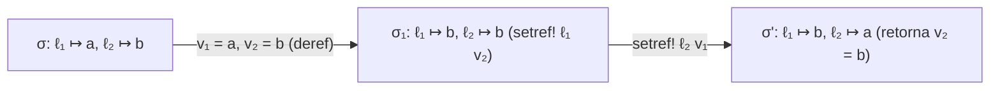

# Informe de corrección — Taller 3: Memoria y disciplina

**Curso:** Fundamentos de Interpretación y Compilación de Lenguajes de Programación — Universidad del Valle, Sede Tuluá.

**Integrantes del grupo:**

| Nombre | Código | Correo institucional |
|--------|--------|----------------------|
| Nicolás Cardona García | 2477349 | nicolas.cardona.garcia@correounivalle.edu.co |
| Laura Sofía Echeverry González | 2477067 | echeverry.laura@correounivalle.edu.co |
| Santiago Serrano Morales | 2477006 | serrano.santiago@correounivalle.edu.co |
| Samuel Esteban Peña Jaramillo | 2477399 | samuel.pena@correounivalle.edu.co |

---

## 1. Marco formal

### 1.1 Corrección de programas recursivos

Sea $f : A \to B$ una función y $A$ un conjunto definido recursivamente. Sea $P_f$ un programa recursivo en Racket que pretende calcular $f$. Decimos que $P_f$ es correcto con respecto a su especificación si se cumple:

$$
\forall a \in A \,:\, P_f(a) = f(a)
$$

La estrategia de demostración es la **inducción estructural** sobre $A$:

- **Caso base:** para cada valor básico $a_0 \in A$ se verifica $P_f(a_0) = f(a_0)$.
- **Caso inductivo:** asumiendo la **hipótesis de inducción** $P_f(a') = f(a')$ para las subestructuras $a'$ que forman $a$, se demuestra $P_f(a) = f(a)$.

Para argumentar la **terminación**, se identifica una medida $\mu : A \to \mathbb{N}$ que decrece estrictamente en cada llamada recursiva y está acotada inferiormente por $0$.

### 1.2 Corrección de programas iterativos y operaciones con estado

Para un programa iterativo o una secuencia de transformaciones sobre un estado mutable se formalizan:

- Un estado $s$ con sus componentes relevantes.
- Un estado inicial $s_0$.
- Una **invariante** $\text{Inv}(s)$ que se mantiene verdadera antes y después de cada operación.
- Una transformación $\text{transformar}(s)$ que produce un nuevo estado $s'$.

La preservación del invariante se demuestra verificando:

1. **Inicialización:** $\text{Inv}(s_0)$ se cumple al iniciar la ejecución.
2. **Mantenimiento:** para toda operación válida del TAD, si $\text{Inv}(\sigma)$ se cumple antes de la operación, entonces $\text{Inv}(\sigma')$ se cumple en el estado resultante $\sigma'$.
3. **Corrección respecto a la especificación:** cada operación cumple su postcondición sobre el estado resultante y el valor retornado (o levanta `eopl:error` exactamente cuando se viola una precondición de validez).

### 1.3 Notación y alcance del análisis

- Un almacén $\sigma$ se modela como una lista finita de valores $[v_0, v_1, \ldots, v_{n-1}]$ de longitud $|\sigma| = n$.
- Escribimos $\sigma(i)$ para el contenido de la celda en la posición $i$ (con $0 \le i < |\sigma|$), que en Racket corresponde a `(list-ref el-almacen i)`.
- Una referencia a la posición $i$ se denota como $\ell_i = \mathrm{a\text{-}ref}(i)$. Por abuso de notación estándar, escribimos $\sigma(\ell_i)$ como sinónimo de $\sigma(i)$.
- La evaluación de una expresión $e$ en el ambiente $\rho$ corresponde a la función `(evaluar-expresion e env)` de `src/interprete.rkt`, denotada $\text{value-of}(e, \rho)$ en el fragmento sin referencias.
- El juicio de tipado $\Gamma \vdash e : t$ corresponde a que `(type-of e amb)` en `src/chequeador.rkt` termina sin error y retorna el tipo $t$.

---

## 2. Funciones analizadas

### 2.1 Invariante del almacén y corrección de sus operaciones (`src/almacen.rkt`)

#### Especificación e invariante formal

El almacén global `el-almacen` guarda una lista de valores indexados desde $0$. Una referencia se construye únicamente mediante el datatype `referencia`:

```racket
(define-datatype referencia referencia?
  (a-ref (pos integer?)))
```

Sea $\sigma$ el estado del almacén y sea $R(\sigma)$ el conjunto de todas las referencias entregadas por `newref!` desde la última invocación de `initialize-store!`. Definimos el **invariante del almacén** $\text{Inv}(\sigma)$ mediante las cuatro condiciones exigidas por el enunciado:

1. **Validez de referencias:** $\forall \ell_i \in R(\sigma) \,:\, 0 \le i < |\sigma|$. Toda referencia entregada por `newref!` apunta a una celda existente del almacén.
2. **Crecimiento monotónico exclusivo de `newref!`:** para cualquier operación distinta de `newref!` (salvo el reinicio de programa mediante `initialize-store!`), si el estado pasa de $\sigma$ a $\sigma'$, entonces $|\sigma'| = |\sigma|$. Para `newref!`, $|\sigma'| = |\sigma| + 1$.
3. **Aislamiento de escritura en `setref!`:** si $\ell_p = \mathrm{a\text{-}ref}(p)$ con $0 \le p < |\sigma|$ y $\sigma'$ es el almacén tras ejecutar `(setref! ref val)`, entonces:
   $$
   \sigma'(p) = \text{val} \quad \land \quad \forall q \in \{0, \ldots, |\sigma|-1\} \,:\, q \neq p \implies \sigma'(q) = \sigma(q).
   $$
4. **Protección de lectura fuera de rango en `deref`:** para toda referencia $\ell_p = \mathrm{a\text{-}ref}(p)$, si $p < 0$ o $p \ge |\sigma|$, entonces `(deref ref)` levanta `eopl:error` y no modifica $\sigma$.

#### Código analizado

```racket
(define el-almacen '())

(define empty-store
  (lambda ()
    '()))

(define initialize-store!
  (lambda ()
    (set! el-almacen (empty-store))))

(define posicion-valida?
  (lambda (pos)
    (and (>= pos 0) (< pos (length el-almacen)))))

(define reemplazar-celda
  (lambda (lst pos val)
    (if (= pos 0)
        (cons val (cdr lst))
        (cons (car lst) (reemplazar-celda (cdr lst) (- pos 1) val)))))

(define newref!
  (lambda (val)
    (let ((pos (length el-almacen)))
      (set! el-almacen (append el-almacen (list val)))
      (a-ref pos))))

(define deref
  (lambda (ref)
    (cases referencia ref
      (a-ref (pos)
             (if (posicion-valida? pos)
                 (list-ref el-almacen pos)
                 (eopl:error 'deref
                             "Referencia fuera de rango: ~s (el almacen tiene ~s celdas)"
                             pos (length el-almacen)))))))

(define setref!
  (lambda (ref val)
    (cases referencia ref
      (a-ref (pos)
             (if (posicion-valida? pos)
                 (set! el-almacen (reemplazar-celda el-almacen pos val))
                 (eopl:error 'setref!
                             "Referencia fuera de rango: ~s (el almacen tiene ~s celdas)"
                             pos (length el-almacen)))))))
```

#### Corrección de `reemplazar-celda`

**Enunciado.** Para toda lista no vacía $L$, todo entero $p$ tal que $0 \le p < |L|$ y todo valor $v$, si $L' = (\text{reemplazar-celda } L\ p\ v)$, entonces:

1. $|L'| = |L|$.
2. $L'(p) = v$.
3. $\forall q \in \{0, \ldots, |L|-1\} \,:\, q \neq p \implies L'(q) = L(q)$.

**Demostración por inducción sobre $p \in \mathbb{N}$.**

- **Caso base ($p = 0$):** como $0 < |L|$, la lista tiene la forma $L = \text{cons}(x_0, L_r)$ con $|L_r| = |L| - 1$. La función evalúa la rama verdadera del `if` y retorna $L' = \text{cons}(v, L_r)$:
  - $|L'| = 1 + |L_r| = |L|$.
  - $L'(0) = \text{car}(L') = v$.
  - Para todo $q$ con $1 \le q < |L|$, $L'(q) = L_r(q - 1) = L(q)$.

- **Caso inductivo ($p = k + 1$ con $k \ge 0$):** como $p < |L|$, necesariamente $|L| \ge 2$, por lo que $L = \text{cons}(x_0, L_r)$ con $0 \le k < |L_r|$. La función ejecuta `(cons (car lst) (reemplazar-celda (cdr lst) (- pos 1) val))`, es decir, $L' = \text{cons}(x_0, L_r')$ donde $L_r' = (\text{reemplazar-celda } L_r\ k\ v)$.

  Por **hipótesis de inducción** sobre $k < p$:
  - $|L_r'| = |L_r|$.
  - $L_r'(k) = v$.
  - $\forall q' \in \{0, \ldots, |L_r|-1\} \,:\, q' \neq k \implies L_r'(q') = L_r(q')$.

  Entonces, para $L' = \text{cons}(x_0, L_r')$:
  - $|L'| = 1 + |L_r'| = 1 + |L_r| = |L|$.
  - $L'(k + 1) = L_r'(k) = v$.
  - Para $q = 0$: $q \neq k + 1$ y $L'(0) = x_0 = L(0)$.
  - Para $q \ge 1$ con $q \neq k + 1$: sea $q' = q - 1 \neq k$; entonces $L'(q) = L_r'(q') = L_r(q') = L(q)$.

- **Terminación:** la medida $\mu(p) = p \in \mathbb{N}$ decrece estrictamente en $1$ en cada llamada recursiva (`(- pos 1)`) y alcanza el caso base $p = 0$ en exactamente $p$ pasos. $\square$

#### Demostración de preservación del invariante

- **Estado inicial (`initialize-store!`):** establece $\sigma_0 = []$, de modo que $|\sigma_0| = 0$ y $R(\sigma_0) = \varnothing$. La condición 1 se cumple vacuamente porque no existen referencias entregadas; ninguna celda previa fue alterada.

- **Operación 1: `newref!`**
  Sea $\sigma$ un almacén que cumple $\text{Inv}(\sigma)$ con longitud $n = |\sigma|$, y sea $v$ cualquier valor.
  1. `pos` toma el valor $n = |\sigma|$.
  2. `(append el-almacen (list val))` construye $\sigma' = [\sigma(0), \ldots, \sigma(n-1), v]$, cuya longitud es $|\sigma'| = n + 1$.
  3. El valor retornado es $\ell_n = \mathrm{a\text{-}ref}(n)$.
  4. **Verificación del invariante:**
     - Para la nueva referencia $\ell_n$: $0 \le n < n + 1 = |\sigma'|$, y $\sigma'(n) = v$.
     - Para toda referencia previa $\ell_i \in R(\sigma)$: por hipótesis $0 \le i < n < n + 1 = |\sigma'|$, y por definición de `append`, $\sigma'(i) = \sigma(i)$ (ninguna celda existente se altera).
     - La longitud crece exactamente en $1$, cumpliendo la condición 2.

- **Operación 2: `deref`**
  Sea $\sigma$ un almacén que cumple $\text{Inv}(\sigma)$ y sea $\ell_p = \mathrm{a\text{-}ref}(p)$.
  1. `deref` no contiene ninguna llamada a `set!`; por lo tanto $\sigma' = \sigma$ y $|\sigma'| = |\sigma|$. Ninguna celda ni la longitud del almacén se modifican (condiciones 1 y 2 preservadas).
  2. La guarda `(posicion-valida? pos)` verifica exactamente $0 \le p < |\sigma|$.
     - Si es verdadera, `(list-ref el-almacen pos)` retorna $\sigma(p)$ sin error.
     - Si es falsa ($p < 0$ o $p \ge |\sigma|$), se ejecuta la rama alternativa y levanta `eopl:error` con el mensaje de referencia fuera de rango (condición 4 satisfecha).

- **Operación 3: `setref!`**
  Sea $\sigma$ un almacén que cumple $\text{Inv}(\sigma)$, sea $\ell_p = \mathrm{a\text{-}ref}(p)$ y sea $v$ el valor a escribir.
  1. Si `(posicion-valida? pos)` es falsa ($p < 0$ o $p \ge |\sigma|$), `setref!` levanta `eopl:error` sin ejecutar `set!`, por lo que $\sigma' = \sigma$ y el invariante se preserva.
  2. Si `(posicion-valida? pos)` es verdadera ($0 \le p < |\sigma|$), el almacén pasa a $\sigma' = (\text{reemplazar-celda } \sigma\ p\ v)$.
  3. Por el **Lema auxiliar** sobre `reemplazar-celda`:
     - $|\sigma'| = |\sigma|$ (la longitud no cambia, preservando la condición 2 y la validez $0 \le i < |\sigma'|$ de toda $\ell_i \in R(\sigma)$).
     - $\sigma'(p) = v$ (la celda destino queda con el valor escrito).
     - $\forall q \in \{0, \ldots, |\sigma|-1\} \,:\, q \neq p \implies \sigma'(q) = \sigma(q)$ (todas las demás celdas permanecen intactas, satisfaciendo la condición 3).

**Conclusión:** el estado inicial satisface $\text{Inv}(\sigma_0)$ y las operaciones `newref!`, `deref` y `setref!` preservan las cuatro propiedades del invariante en toda ejecución válida.

---

### 2.2 Corrección de `swap-exp` 

#### 1. Especificación formal

Sea $\sigma$ el estado del almacén inmediatamente después de evaluar los dos operandos `e1` y `e2` de `(swap-exp e1 e2)` a los valores $r_1$ y $r_2$, respectivamente.

- **Tipo:** `swap-exp : expresion × expresion × ambiente -> valor` (con efecto sobre el almacén $\sigma \to \sigma'$).
- **Precondición:** $\text{Inv}(\sigma)$ se cumple. En el caso válido, $r_1 = \ell_1 = \mathrm{a\text{-}ref}(p_1)$ y $r_2 = \ell_2 = \mathrm{a\text{-}ref}(p_2)$ son referencias válidas en $\sigma$ (es decir, $0 \le p_1, p_2 < |\sigma|$).
- **Postcondición:**
  - Si alguno de $r_1$ o $r_2$ no satisface `referencia?`, la evaluación levanta `eopl:error` y no modifica $\sigma$.
  - Si ambos son referencias válidas $\ell_1$ y $\ell_2$, entonces el almacén resultante $\sigma'$ y el valor retornado $w$ satisfacen:
    $$
    \begin{aligned}
    |\sigma'| &= |\sigma|, \\
    \sigma'(\ell_1) &= \sigma(\ell_2), \\
    \sigma'(\ell_2) &= \sigma(\ell_1), \\
    \forall \ell \notin \{\ell_1, \ell_2\} \,:\, \sigma'(\ell) &= \sigma(\ell), \\
    w &= \sigma(\ell_2).
    \end{aligned}
    $$

#### Código analizado

```racket
(swap-exp (e1 e2)
  (let* ((ref1 (evaluar-expresion e1 env))
         (ref2 (evaluar-expresion e2 env)))
    (if (and (referencia? ref1) (referencia? ref2))
        (let ((v1 (deref ref1))
              (v2 (deref ref2)))
          (setref! ref1 v2)
          (setref! ref2 v1)
          v2)
        (eopl:error 'swap "swap espera dos referencias: ~s y ~s" ref1 ref2))))
```

#### 2. Demostración de corrección (caso general $\ell_1 \neq \ell_2$)

Primero, el uso de `let*` garantiza que `e1` se evalúe antes que `e2` (izquierda a derecha), produciendo $r_1$ y $r_2$ sobre un estado del almacén $\sigma$.

- **Caso de error:** si $\lnot\text{referencia?}(r_1) \lor \lnot\text{referencia?}(r_2)$, la condición `(and (referencia? ref1) (referencia? ref2))` resulta `#f` y se ejecuta `eopl:error` sin tocar el almacén, cumpliendo la especificación.

- **Caso válido con $\ell_1 \neq \ell_2$:** ambos operandos son referencias válidas $\ell_1$ y $\ell_2$ sobre $\sigma$. Seguimos la secuencia exacta de pasos:

  1. **Lecturas previas:**

```racket
(let ((v1 (deref ref1))
      (v2 (deref ref2)))
  ...)
```

     Como `deref` no modifica el almacén (demostrado en 2.1), ambas lecturas observan el estado original $\sigma$:
     $$
     v_1 = \sigma(\ell_1) \quad \land \quad v_2 = \sigma(\ell_2).
     $$
     El valor original de la primera celda ($\sigma(\ell_1)$) queda resguardado en la ligadura léxica local `v1` **antes** de que se ejecute cualquier escritura. Si se escribiera `ref1` antes de leerla, su contenido original se perdería irreversiblemente; al capturar ambos valores en el `let` previo, eso nunca ocurre.

  2. **Primera escritura:** `(setref! ref1 v2)` transforma $\sigma$ en un estado intermedio $\sigma_1$. Por la propiedad de aislamiento de `setref!` (Sección 2.1):
     $$
     |\sigma_1| = |\sigma|, \qquad \sigma_1(\ell_1) = v_2 = \sigma(\ell_2), \qquad \forall \ell \neq \ell_1 \,:\, \sigma_1(\ell) = \sigma(\ell).
     $$
     En particular, como $\ell_2 \neq \ell_1$, se tiene $\sigma_1(\ell_2) = \sigma(\ell_2)$, y el valor original de $\ell_1$ sigue disponible intacto en `v1`.

  3. **Segunda escritura:** `(setref! ref2 v1)` transforma $\sigma_1$ en el estado final $\sigma'$. Aplicando nuevamente la propiedad de `setref!`:
     - $|\sigma'| = |\sigma_1| = |\sigma|$.
     - Para $\ell_2$: $\sigma'(\ell_2) = v_1 = \sigma(\ell_1)$.
     - Para $\ell_1$: como $\ell_1 \neq \ell_2$, la segunda escritura no toca $\ell_1$, por lo tanto $\sigma'(\ell_1) = \sigma_1(\ell_1) = \sigma(\ell_2)$.
     - Para toda otra celda $\ell \notin \{\ell_1, \ell_2\}$: ni la primera ni la segunda escritura tocan $\ell$, así que $\sigma'(\ell) = \sigma_1(\ell) = \sigma(\ell)$.



#### 3. Análisis del caso de alias ($\ell_1 = \ell_2$)

Cuando las dos referencias apuntan a la misma celda ($\ell_1 = \ell_2 = \ell_0$), la especificación exige:

$$
\sigma'(\ell_0) = \sigma(\ell_0), \qquad \forall \ell \neq \ell_0 \,:\, \sigma'(\ell) = \sigma(\ell), \qquad w = \sigma(\ell_0).
$$

Es decir, intercambiar una celda consigo misma debe ser una operación idempotente sobre el almacén ($\sigma' = \sigma$) y retornar su contenido actual.

Verificamos la ejecución de nuestra implementación cuando `ref1` = `ref2` = $\ell_0$ y $\sigma(\ell_0) = a$:

1. Las lecturas previas obtienen $v_1 = \sigma(\ell_0) = a$ y $v_2 = \sigma(\ell_0) = a$.
2. `(setref! ref1 v2)` escribe $a$ en $\ell_0$, dejando $\sigma_1(\ell_0) = a$ y toda $\ell \neq \ell_0$ intacta ($\sigma_1 = \sigma$).
3. `(setref! ref2 v1)` escribe $a$ en $\ell_0$, dejando $\sigma'(\ell_0) = a = \sigma(\ell_0)$ y toda $\ell \neq \ell_0$ intacta ($\sigma' = \sigma$).
4. El valor retornado es `v2`, que vale $a = \sigma(\ell_0)$.

La implementación cumple exactamente lo que exige la especificación en el caso $\ell_1 = \ell_2$, sin corromper ni duplicar celdas.

#### 4. Valor retornado y terminación

- **Valor retornado:** la última expresión del cuerpo del `let` en `swap-exp` es `v2`. Por la etapa de lecturas previas, `v2` está ligado a `(deref ref2)` evaluado en $\sigma$, es decir, $w = \sigma(\ell_2)$. Esto coincide tanto en el caso $\ell_1 \neq \ell_2$ como en el caso $\ell_1 = \ell_2$ con el contenido anterior de la segunda celda (que a su vez es el valor que quedó almacenado en $\ell_1$).
- **Terminación:** `swap-exp` no es recursivo en sí mismo. Una vez terminan las evaluaciones de `e1` y `e2`, realiza exactamente dos verificaciones `referencia?`, dos lecturas `deref` y dos escrituras `setref!` (cada una con terminación demostrada en la Sección 2.1). Por tanto, `swap-exp` siempre termina en un número finito de pasos siempre que `e1` y `e2` terminen.

**Conclusión:** la implementación de `swap-exp` en `src/interprete.rkt` es correcta respecto a su especificación formal en todos los casos (referencias distintas, alias $\ell_1 = \ell_2$ y operandos inválidos).

---

## 3. Propiedades adicionales

### 3.1 Solidez del chequeador estático de tipos (`src/chequeador.rkt` y `src/tipos.rkt`)

#### Enunciado para el fragmento sin referencias

Consideremos el fragmento funcional de Cauca sin referencias (es decir, excluyendo `newref-exp`, `deref-exp`, `setref-exp`, `swap-exp` y `app-ref-exp`). En este fragmento el almacén no interviene, el paso por valor en `app-exp` no copia ninguna celda (`copia-por-valor` actúa como la función identidad sobre números, booleanos y clausuras) y la evaluación depende únicamente de la expresión y el ambiente de valores.

**Teorema (Solidez del chequeador sin referencias).**
Para toda expresión $e$ del fragmento sin referencias, todo ambiente de tipos $\Gamma$, todo ambiente de valores $\rho$ y todo tipo $t$:

$$
\text{Si } \Gamma \vdash e : t \text{ y } \rho \text{ concuerda con } \Gamma, \text{ entonces } \text{value-of}(e, \rho) \text{ es un valor de tipo } t \text{ (si la evaluación termina).}
$$

*(Nota: la aclaración de terminación es necesaria porque el lenguaje incluye `letrec`, lo que permite escribir expresiones bien tipadas que no terminan, como una recursión infinita; el teorema garantiza que el programa no se atasca con un error de tipo en tiempo de ejecución y en caso de producir un valor, este tiene el tipo $t$.)*

#### Definición formal: valores de tipo $t$ y concordancia entre $\rho$ y $\Gamma$

Primero precisamos qué significa que un valor $v$ tenga tipo $t$, lo cual escribimos $v : t$:

1. $v : \mathrm{num}$ si y solo si $v$ es un número de Racket (`(number? v)`).
2. $v : \mathrm{bool}$ si y solo si $v$ es un booleano de Racket (`(boolean? v)`).
3. $v : (t_1 * \cdots * t_k \to t_r)$ si y solo si $v = \mathrm{cerradura}((x_1, \ldots, x_k), B, \rho_d)$ es un `procval` tal que para toda tupla de valores $(a_1, \ldots, a_k)$ que satisfaga $a_i : t_i$ ($1 \le i \le k$), la evaluación de $\text{value-of}(B, \mathrm{ext}((x_1, \ldots, x_k), (a_1, \ldots, a_k), \rho_d))$ produce (si termina) un valor de tipo $t_r$.

Con esta noción, definimos la **concordancia entre ambientes** ($\rho \models \Gamma$):

Decimos que un ambiente de valores $\rho$ **concuerda** con un ambiente de tipos $\Gamma$ (escrito $\rho \models \Gamma$) si y solo si:

1. Todo identificador declarado en $\Gamma$ está ligado en $\rho$: $\mathrm{dom}(\Gamma) \subseteq \mathrm{dom}(\rho)$.
2. Para todo identificador $x \in \mathrm{dom}(\Gamma)$, el valor obtenido por `apply-env` tiene el tipo reportado por `apply-tenv`:
   $$
   \forall x \in \mathrm{dom}(\Gamma) \,:\, \text{apply-env}(\rho, x) : \text{apply-tenv}(\Gamma, x).
   $$

En particular, los ambientes iniciales cumplen $\rho_0 \models \Gamma_0$: `ambiente-inicial` liga `n, m, p, q, r` a los números `10, 3, 7, 2, 5`, y `tenv-inicial` en `src/tipos.rkt` declara exactamente esos cinco identificadores con `(num-tipo)`.

Además, la concordancia se preserva bajo extensión: si $\rho \models \Gamma$ y $a_i : t_i$ para todo $1 \le i \le k$, entonces:

$$
\text{ambiente-extendido}((x_1, \ldots, x_k), (a_1, \ldots, a_k), \rho) \models \text{tenv-extendido}((x_1, \ldots, x_k), (t_1, \ldots, t_k), \Gamma).
$$

#### Demostración por inducción sobre la derivación de tipos

Procedemos por inducción estructural sobre la derivación de $\Gamma \vdash e : t$ (equivalente a la estructura de las llamadas recursivas en `type-of`). Asumimos como **hipótesis de inducción (HI)** que la propiedad se cumple para todas las subderivaciones inmediatas de $\Gamma \vdash e : t$.

##### Caso 1: expresión condicional (`if-exp`)

En `src/chequeador.rkt`, la regla implementada para `(if-exp exp1 exp2 exp3)` establece que $\Gamma \vdash \text{if } e_1 \text{ then } e_2 \text{ else } e_3 \text{ end} : t$ se deriva únicamente cuando:

1. $\Gamma \vdash e_1 : \mathrm{bool}$,
2. $\Gamma \vdash e_2 : t$,
3. $\Gamma \vdash e_3 : t$ (ya que `type-of` exige `(tipos-iguales? tipo-then tipo-else)` y retorna `tipo-then`).

Supongamos que $\rho \models \Gamma$. Por la implementación de `if-exp` en `src/interprete.rkt`:

```racket
(if-exp (condicion verdadera falsa)
  (let ((c (evaluar-expresion condicion env)))
    (if (boolean? c)
        (if c
            (evaluar-expresion verdadera env)
            (evaluar-expresion falsa env))
        (eopl:error 'if "La condicion del if debe ser booleana: ~s" c))))
```

1. Aplicando la **HI** a la subderivación (1) con $\rho \models \Gamma$, obtenemos que $c = \text{value-of}(e_1, \rho)$ es un valor de tipo $\mathrm{bool}$, es decir, `(boolean? c)` es `#t`. Por lo tanto, la evaluación **no** entra en la rama de `eopl:error` y necesariamente se cumple $c = \text{\#t}$ o $c = \text{\#f}$.
2. **Subcaso $c = \text{\#t}$:** el intérprete evalúa $\text{value-of}(e_2, \rho)$. Por la **HI** aplicada a la subderivación (2) con $\rho \models \Gamma$, el resultado es un valor de tipo $t$.
3. **Subcaso $c = \text{\#f}$:** el intérprete evalúa $\text{value-of}(e_3, \rho)$. Por la **HI** aplicada a la subderivación (3) con $\rho \models \Gamma$, el resultado es un valor de tipo $t$.

En ambos subcasos, $\text{value-of}(\text{if } e_1 \text{ then } e_2 \text{ else } e_3 \text{ end}, \rho)$ es un valor de tipo $t$. $\square$

##### Caso 2: aplicación de procedimientos (`app-exp`)

En `src/chequeador.rkt`, la regla implementada para `(app-exp rator rands)` con $\text{rands} = (e_1, \ldots, e_k)$ establece que $\Gamma \vdash \text{apply } e_0(e_1, \ldots, e_k) : t_r$ se deriva únicamente cuando:

1. $\Gamma \vdash e_0 : (t_1 * \cdots * t_k \to t_r)$ (es decir, `tipo-operador` es `(proc-tipo tipos-args tipo-resultado)` con longitud $k$).
2. La cantidad de argumentos coincide con la cantidad de parámetros: $|\text{rands}| = k$.
3. Para cada $i \in \{1, \ldots, k\}$, $\Gamma \vdash e_i : t_i$ (validado por `verificar-tipos-argumentos` con `tipos-iguales?`).

Supongamos que $\rho \models \Gamma$. En `src/interprete.rkt`, la cláusula de `app-exp` y `apply-procedure` ejecuta:

```racket
(app-exp (rator rands)
  (let ((proc (evaluar-expresion rator env)))
    (if (procval? proc)
        (apply-procedure proc (copiar-valores (evaluar-lista rands env)))
        (eopl:error 'apply "Se intento aplicar algo que no es un procedimiento: ~s" proc))))
```

1. Aplicando la **HI** a la subderivación (1) con $\rho \models \Gamma$, obtenemos que $p = \text{value-of}(e_0, \rho)$ es un valor de tipo $(t_1 * \cdots * t_k \to t_r)$.
2. Por la definición de valor de tipo procedimental:
   - $p$ es una clausura válida `cerradura`($X, B, \rho_d$), por lo cual `(procval? proc)` es `#t` y no se levanta el error de operador no procedimental.
   - La cantidad de parámetros formales es $|X| = k$.
3. Aplicando la **HI** a cada subderivación $\Gamma \vdash e_i : t_i$ ($1 \le i \le k$) con $\rho \models \Gamma$, `evaluar-lista` produce una lista de $k$ valores $(a_1, \ldots, a_k)$ donde $a_i : t_i$ para todo $i$. Como estamos en el fragmento sin referencias, `copiar-valores` devuelve la misma lista $(a_1, \ldots, a_k)$.
4. Dentro de `apply-procedure`, la comprobación `(= (length ids) (length args))` evalúa `(= k k)` $\to$ `#t`, por lo cual no se levanta el error de aridad y se evalúa el cuerpo $B$ en `(ambiente-extendido X (a_1 ... a_k) rho_d)`.
5. Por la definición de valor de tipo $(t_1 * \cdots * t_k \to t_r)$ aplicada a $p$ y a los argumentos $(a_1, \ldots, a_k)$ con $a_i : t_i$, el resultado de evaluar el cuerpo es un valor de tipo $t_r$.

En consecuencia, $\text{value-of}(\text{apply } e_0(e_1, \ldots, e_k), \rho)$ es un valor de tipo $t_r$. $\square$

#### Qué se rompe al agregar referencias y por que el enunciado debe incluir el almacen

Cuando se incorporan `newref`, `deref`, `setref`, `swap` y `applyref`, el enunciado anterior («si $\Gamma \vdash e : t$ y $\rho \models \Gamma$, entonces $\text{value-of}(e, \rho) : t$») **deja de ser suficiente e incluso deja de poder formularse** por 3 razones fundamentales:

1. **Una referencia por si sola no revela el tipo de su contenido:** el valor en tiempo de ejecución de una expresión de tipo `refto(num)` es simplemente `(a-ref i)`, una posición entera envuelta en un constructor. Sin mirar el almacén $\sigma$ en la posición $i$, es imposible saber si esa celda existe o si realmente contiene un `num` y no un `bool` o una clausura. Por tanto, el predicado $v : t$ ya no depende solo de $v$, sino del almacén vigente.
2. **La evaluacion transforma el estado global y genera nuevas celdas:** evaluar `e` ya no produce un valor sino una pareja $\langle v, \sigma' \rangle$ a partir de un almacén inicial $\sigma$. En una secuencia `begin`, en los operandos de `setref` o en un `swap`, una subexpresión puede modificar celdas a las que apuntan variables ya presentes en $\rho$. Si una escritura cambiara el tipo guardado en una celda, una lectura posterior mediante `deref` fallaría aunque $\rho$ y $\Gamma$ no hayan cambiado.
3. **Se necesita un tipado del almacén ($\Sigma$) y una relacion de consistencia $\sigma \models \Sigma$:** para restaurar la solidez con referencias, el teorema debe introducir un **ambiente de tipos de almacen** $\Sigma$ que asigne a cada posicion reservada $\ell_i$ el tipo $t_i$ que esa celda debe guardar, y exigir que:
   - $\sigma$ sea consistente con $\Sigma$ (cada celda $\sigma(i)$ contiene un valor de tipo $\Sigma(i)$).
   - $\rho$ concuerde con $\Gamma$ bajo $\Sigma$ (si $\Gamma(x) = \mathrm{refto}(t)$, entonces $\rho(x) = \ell_i$ con $\Sigma(i) = t$).
   - Al evaluar $e$ desde un almacén consistente $\sigma$, la evaluación produzca un valor $v$ de tipo $t$ y un almacén final $\sigma'$ que siga siendo consistente con una extensión $\Sigma' \supseteq \Sigma$, las celdas viejas conservan su tipo gracias a las reglas de `setref` y `swap`, y las celdas nuevas creadas por `newref` quedan registradas en $\Sigma'$ con el tipo de su valor inicial.

---

## 4. Referencias

- Delgado S., C. A. *Taller 3: Memoria y disciplina*. Enunciado del curso, Universidad del Valle, Sede Tuluá.
- Implementación del grupo: `src/almacen.rkt`, `src/ambiente.rkt`, `src/interprete.rkt`, `src/tipos.rkt` y `src/chequeador.rkt`.